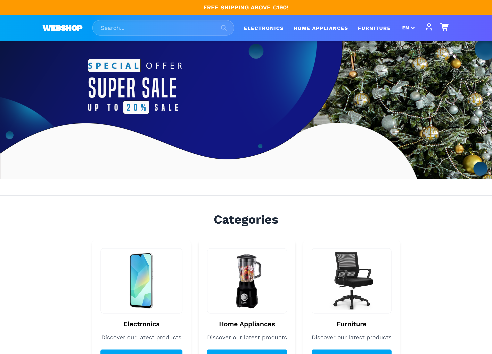
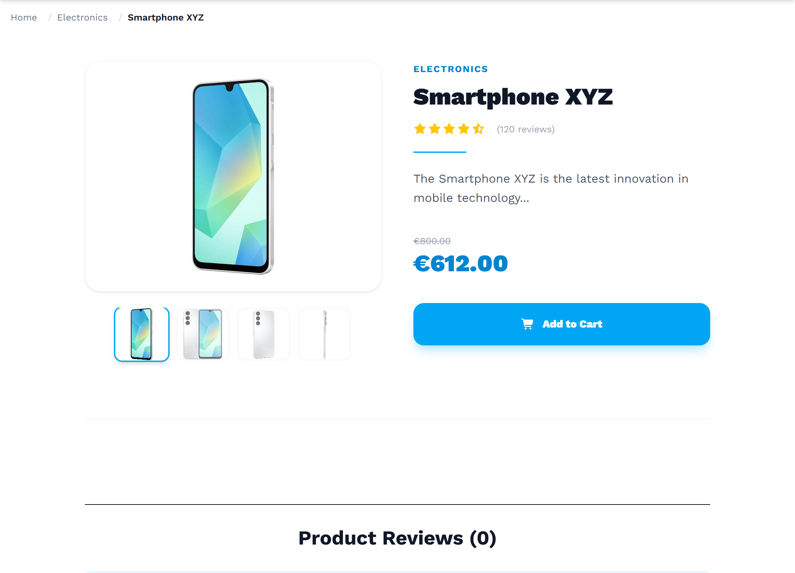
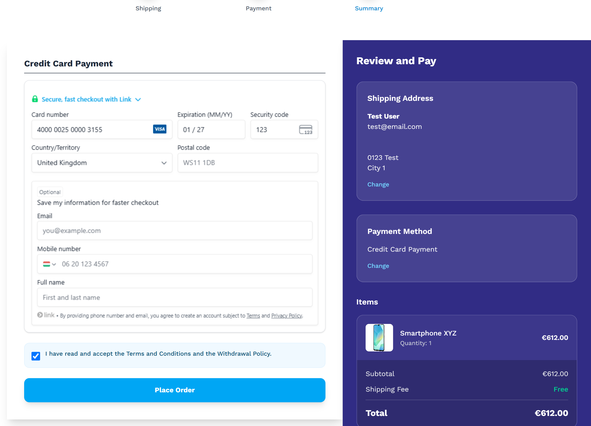
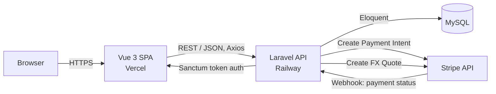

# Webshop

Full-stack e-commerce application with a Vue 3 storefront, a Laravel REST API, and Stripe-powered checkout.

[](https://vuejs.org/)
[](https://www.typescriptlang.org/)
[](https://laravel.com/)
[](https://stripe.com/)
[](https://www.mysql.com/)
[](https://github.com/tibor-kovacs-dev/webshop/actions/workflows/backend.yml)
[](https://github.com/tibor-kovacs-dev/webshop/actions/workflows/frontend.yml)

**Live demo:** https://project-pf3cc.vercel.app/

---

## Screenshots

| Home | Product detail | Checkout |
|---|---|---|
|  |  |  |

---

## Overview

Webshop is a full-stack online store built to demonstrate a production-style separation between a decoupled SPA frontend and a REST API backend. The frontend is a Vue 3 + TypeScript application (Vite, Pinia, Vue Router, i18n) deployed on Vercel; the backend is a Laravel 12 API deployed on Railway, backed by MySQL and Stripe for payments, including multi-currency support.

## Architecture



- **Frontend → Backend:** JSON REST calls over HTTPS, authenticated with Laravel Sanctum tokens.
- **Backend → Database:** Eloquent ORM against MySQL (SQLite for local development).
- **Payments:** the backend creates a Stripe Payment Intent; the frontend confirms it client-side with Stripe.js; Stripe notifies the backend of the final payment status via webhook.
- **Multi-currency:** if the customer's selected currency isn't the store's base currency (HUF), the frontend requests a Stripe FX Quote (rate locked for one hour) before creating the payment intent, so the charged amount matches what was displayed at checkout.

## Tech Stack

| | Frontend | Backend |
|---|---|---|
| Core | Vue 3 (Composition API, `<script setup>`), TypeScript, Vite | Laravel 12, PHP 8.2 |
| State / Data | Pinia (with persisted state), Axios | Eloquent ORM, MySQL |
| Auth | Sanctum token stored client-side | Laravel Sanctum |
| Payments | Stripe.js / `@vue-stripe/vue-stripe` | `stripe/stripe-php`, Stripe FX Quotes, webhook handling |
| i18n | vue-i18n (EN / DE / HU) | `spatie/laravel-translatable` (translatable product content) |
| Styling | Tailwind CSS | — |
| Testing | Vitest (unit), Playwright (e2e) | PHPUnit |
| CI | GitHub Actions — build + unit tests on every push/PR | GitHub Actions — `php artisan test` on every push/PR |
| Deployment | Vercel | Railway |

## Key Features

**Storefront**
- Product catalog with category filtering, new arrivals and discounted items
- Product detail pages with comments/reviews
- Shopping cart and wishlist with persisted state
- Multi-language UI (English, German, Hungarian)
- Multi-currency prices (HUF, EUR, USD) with a locked FX rate carried through to checkout

**Accounts**
- Registration, login, email verification
- Password reset flow
- User profile and order history

**Checkout & Payments**
- Stripe-based checkout with payment intent creation
- Currency conversion via Stripe FX Quotes for non-HUF checkouts
- Retry payment on failed orders
- Refund requests
- Stripe webhook for asynchronous payment status updates

**Admin-facing**
- Authenticated product create / update / delete endpoints

## Project Structure

```
webshop/
├── frontend/          # Vue 3 + TypeScript SPA (Vercel)
│   ├── src/
│   │   ├── views/         # Page-level components
│   │   ├── components/    # Reusable UI components
│   │   ├── stores/        # Pinia stores (cart, auth, orders, wishlist, checkout...)
│   │   ├── router/
│   │   └── locales/       # en / de / hu translations
│   └── vercel.json
├── backend/           # Laravel 12 REST API (Railway)
│   ├── app/
│   │   ├── Http/Controllers/   # Products, Orders, Payment (incl. FX quotes), Users, Auth...
│   │   ├── Models/             # Product, Order, OrderItem, Review, User
│   │   └── Jobs/ Mail/         # Order confirmation & notification emails
│   ├── database/migrations/
│   └── routes/api.php
├── .github/workflows/  # frontend.yml, backend.yml
└── README.md
```

## Getting Started

### Prerequisites

- Node.js `^20.19.0` or `>=22.12.0`
- PHP `^8.2` and Composer
- MySQL (or SQLite for quick local setup)
- A Stripe account (test mode keys are enough for local development)

### Backend setup

```bash
cd backend
composer install
cp .env.example .env
php artisan key:generate
```

Edit `.env` and set your database credentials (defaults to SQLite; switch `DB_CONNECTION` to `mysql` and fill in `DB_HOST` / `DB_DATABASE` / `DB_USERNAME` / `DB_PASSWORD` for MySQL), plus your Stripe secret key.

```bash
php artisan migrate --seed
php artisan serve
```

The API will be available at `http://localhost:8000`.

### Frontend setup

```bash
cd frontend
npm install
```

Create a `.env` file in `frontend/` with:

```
VITE_API_BASE_URL=http://localhost:8000
VITE_STRIPE_PUBLIC_KEY=pk_test_your_stripe_public_key
```

```bash
npm run dev
```

The app will be available at `http://localhost:5173`.

### Production build

```bash
cd frontend
npm run build   # outputs to frontend/dist
```

## Environment Variables

**Backend (`backend/.env`)** — key variables, see `.env.example` for the full list:

| Variable | Description |
|---|---|
| `APP_URL` | Public URL of the API |
| `DB_CONNECTION`, `DB_HOST`, `DB_DATABASE`, `DB_USERNAME`, `DB_PASSWORD` | Database connection |
| `STRIPE_KEY` / `STRIPE_SECRET` | Stripe API credentials (also used for FX Quotes) |
| `MAIL_*` | Outgoing mail configuration (order confirmations, password reset) |

**Frontend (`frontend/.env`)**

| Variable | Description |
|---|---|
| `VITE_API_BASE_URL` | Base URL of the Laravel API |
| `VITE_STRIPE_PUBLIC_KEY` | Stripe publishable key |

## Deployment

| | Platform | Root Directory | Build |
|---|---|---|---|
| Frontend | [Vercel](https://vercel.com) | `frontend` | `npm run build` → `dist` |
| Backend | [Railway](https://railway.app) | `backend` | Composer + Laravel, MySQL plugin attached |

## Testing

```bash
# Backend
cd backend
php artisan test

# Frontend — unit tests
cd frontend
npm run test

# Frontend — end-to-end tests
npx playwright test
```
