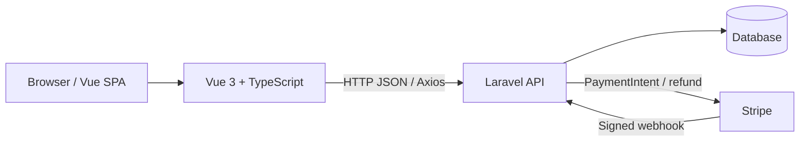

# Webshop

A full-stack e-commerce application with a Vue 3 + TypeScript storefront and a Laravel REST API. The backend handles product pricing, order creation, stock reservations, Stripe PaymentIntents, payment retries, refund requests, and Stripe webhook processing.

> **Documentation note:** This README describes the application based on the source code and project configuration. Deployment URLs, demo credentials, and external service availability can change independently of the code.

## Project at a glance

- **Frontend:** Vue 3, TypeScript, Vite, Vue Router, Pinia, Axios, vue-i18n, Tailwind CSS
- **Backend:** Laravel 12, PHP 8.2+, Laravel Sanctum, Eloquent
- **Payments:** Stripe PaymentIntents and Stripe webhooks
- **Database:** Laravel-supported database connection; the checked-in environment example is configured for MySQL
- **Tests:** Vitest and Vue Test Utils on the frontend; PHPUnit / Laravel tests on the backend
- **Frontend hosting configuration:** Vercel (`frontend/vercel.json`)
- **CI:** GitHub Actions workflows are present under `.github/workflows/`

## Features

### Storefront
- Product catalog and product detail pages
- Category browsing, new arrivals, and discounted products
- Product comments/reviews
- Shopping cart and wishlist
- Hungarian, English, and German interface translations
- HUF, EUR, and USD price display and checkout support

### Accounts
- Registration and login
- Sanctum-based authenticated API access
- User profile and password change
- Email verification and resend-verification flow
- Password reset
- Order history and order detail access

### Checkout and payments
- Server-side order pricing and amount calculation
- Stripe PaymentIntent creation
- Order creation associated with a PaymentIntent
- Payment finalization and retry flow
- Refund requests
- Stripe webhook signature verification and event deduplication
- Stock reservation and release logic associated with order/payment lifecycle

### Admin API
- Authenticated admin endpoints for creating, updating, and deleting products

## Architecture



The frontend communicates with the Laravel API using Axios. The backend is responsible for authoritative product pricing and payment-related validation. Stripe sends payment events to the backend webhook endpoint.

Authentication routes use Laravel Sanctum. The frontend Axios configuration enables credentials and XSRF handling; configure the frontend and backend origins/cookies consistently for the environment where they are deployed.

## Repository structure

```text
webshop/
├── frontend/
│   ├── src/
│   │   ├── components/     # Reusable UI components and component tests
│   │   ├── views/          # Page views
│   │   ├── stores/         # Pinia stores (auth, cart, checkout, products, etc.)
│   │   ├── router/         # Vue Router configuration
│   │   ├── locales/        # Translation resources
│   │   └── ...
│   ├── package.json
│   ├── vercel.json
│   └── ...
└── backend/
    ├── app/
    │   ├── Http/Controllers/  # API controllers
    │   ├── Http/Requests/     # Request validation
    │   ├── Models/            # Eloquent models
    │   ├── Services/           # Pricing and stock reservation logic
    │   └── ...
    ├── routes/
    │   └── api.php             # API route definitions
    ├── database/
    │   ├── migrations/
    │   └── seeders/
    ├── tests/                  # Laravel/PHPUnit tests
    ├── composer.json
    └── ...
```

## Requirements

Install the following before running the project:

- PHP **8.2 or newer**
- Composer
- Node.js compatible with the frontend `engines` declaration (Node **20.19+** or **22.12+**)
- npm
- A database supported by your Laravel configuration (MySQL is shown in `backend/.env.example`)
- Stripe account and API credentials for real payment integration

## Local development

### 1. Backend

```bash
cd backend
composer install
```

Create the local environment file from the example:

```bash
cp .env.example .env
```

Configure at least the application key, database connection, frontend URL/CORS and Stripe credentials as appropriate for your local setup. Do not commit `.env` or real credentials.

Generate the Laravel application key and run migrations:

```bash
php artisan key:generate
php artisan migrate
```

Start the API:

```bash
php artisan serve
```

The backend package also defines a Composer development command:

```bash
composer run dev
```

This command starts Laravel's development server, queue listener, log tailer, and Vite process together. Use it only if the required frontend dependencies have been installed and the command's concurrent processes are suitable for your environment.

### 2. Frontend

In another terminal:

```bash
cd frontend
npm install
```

Create/configure the frontend environment file and set the API base URL and Stripe publishable key:

```env
VITE_API_BASE_URL=http://127.0.0.1:8000
VITE_STRIPE_PUBLIC_KEY=your_stripe_publishable_key
```

These are frontend build-time variables. **Never put a Stripe secret key or other server secret in a `VITE_` variable.**

Run the development server:

```bash
npm run dev
```

Build the frontend:

```bash
npm run build
```

Preview the production build locally:

```bash
npm run preview
```

## Environment configuration

### Frontend

The source code reads these frontend environment variables:

| Variable | Purpose |
|---|---|
| `VITE_API_BASE_URL` | Base URL used for API requests |
| `VITE_STRIPE_PUBLIC_KEY` | Stripe publishable key used by the browser |

Set these in the frontend environment for local development and in the frontend hosting provider for production builds.

### Backend

Laravel configuration is driven by `backend/.env`. Relevant settings include:

| Variable | Purpose |
|---|---|
| `APP_KEY` | Laravel application encryption key |
| `APP_URL` | Backend application URL |
| `FRONTEND_URL` | Frontend origin used by application configuration |
| `CORS_ALLOWED_ORIGINS` | Allowed frontend origins, where configured |
| `DB_*` | Database connection |
| `SESSION_*` | Session and cookie configuration |
| `STRIPE_KEY` | Stripe publishable key (backend configuration) |
| `STRIPE_SECRET` | Stripe secret key; server-side only |
| `STRIPE_WEBHOOK_SECRET` | Stripe webhook signing secret |
| `STRIPE_CURRENCY` | Default Stripe currency setting |

Use `backend/.env.example` as the authoritative list of environment variables supported by the checked-in Laravel configuration. Some Laravel variables are framework defaults and may not be required for every deployment.

## API overview

The routes are defined in `backend/routes/api.php`. The following is a high-level route map; validation and response details are defined in the controllers.

### Public product endpoints

| Method | Endpoint | Purpose |
|---|---|---|
| `GET` | `/api/products` | Product catalog |
| `GET` | `/api/products/new` | New arrivals |
| `GET` | `/api/products/discounted` | Discounted products |
| `GET` | `/api/products/categories` | Product categories |
| `GET` | `/api/products/category/{category}` | Products in a category |
| `GET` | `/api/products/prices` | Price lookup |
| `GET` | `/api/products/{slug}` | Product detail |
| `GET` | `/api/products/{id}/comments` | Product comments |

### Account endpoints

| Method | Endpoint | Access |
|---|---|---|
| `POST` | `/api/users/register` | Public, rate-limited |
| `POST` | `/api/users/login` | Public, rate-limited |
| `POST` | `/api/users/logout` | Authenticated |
| `GET` | `/api/users/me` | Authenticated |
| `PATCH` | `/api/users/profile` | Authenticated |
| `POST` | `/api/users/change-password` | Authenticated |
| `POST` | `/api/password/forgot` | Public |
| `POST` | `/api/password/reset` | Public |
| `GET` | `/api/email/verify/{id}/{hash}` | Signed URL |
| `POST` | `/api/email/resend` | Authenticated, rate-limited |

### Orders and checkout

These routes require Sanctum authentication:

| Method | Endpoint | Purpose |
|---|---|---|
| `GET` | `/api/orders` | Current user's orders |
| `GET` | `/api/orders/{order}` | Order detail |
| `POST` | `/api/checkout/create-intent` | Create Stripe PaymentIntent |
| `POST` | `/api/orders` | Create order |
| `POST` | `/api/orders/finalize` | Finalize/check payment |
| `POST` | `/api/orders/{order}/retry` | Retry payment |
| `POST` | `/api/order/{orderId}/refund` | Request refund |

### Stripe webhook

| Method | Endpoint | Purpose |
|---|---|---|
| `POST` | `/api/stripe/webhook` | Receive Stripe events |

The webhook endpoint is not authenticated with a user session; it validates the Stripe signature using `STRIPE_WEBHOOK_SECRET`.

### Admin product endpoints

Product creation, update, and deletion require both Sanctum authentication and the `admin` middleware:

- `POST /api/products`
- `PATCH /api/products/{id}`
- `DELETE /api/products/{id}`

## Pricing and payment flow

1. The frontend submits product IDs, quantities, and the selected currency to request a PaymentIntent.
2. The backend calculates the prices from its product data and pricing services; client-submitted prices are not treated as authoritative.
3. The backend creates a Stripe PaymentIntent and returns its client secret and ID.
4. The frontend confirms the payment with Stripe.
5. The backend creates/updates the order and associates it with the payment.
6. Stripe sends payment status events to the webhook endpoint.
7. The backend processes payment status, stock lifecycle, and applicable order notifications/refund actions.

The application supports HUF, EUR, and USD in the checkout/pricing code. Exchange-rate and rounding behavior is implemented in backend pricing services and configuration. Do not assume the frontend's displayed price is authoritative: the backend recalculates the payable amount.

## Testing

### Frontend

```bash
cd frontend
npm test
```

The frontend package also exposes:

```bash
npm run test:unit
```

These commands run Vitest. Playwright is included as a development dependency; use the project's Playwright configuration and test files for browser tests.

### Backend

```bash
cd backend
php artisan test
```

or:

```bash
composer test
```

The backend test suite uses Laravel's PHPUnit-based test runner.

> Tests are not guaranteed to pass merely because the commands are documented. Run them in your configured environment and check the actual output.

## Deployment notes

### Frontend

The repository includes `frontend/vercel.json`, configured to:

- install dependencies with `npm install`
- build with `npm run build`
- publish the `dist` directory
- rewrite application routes to `index.html` for SPA routing

Set the frontend environment variables in Vercel before building/deploying.

### Backend

The backend is a Laravel application. Deploy it to a PHP-compatible host with:

- the required PHP extensions and Composer dependencies
- production environment variables
- database migrations applied
- correct `APP_URL`, frontend origin/CORS, and Sanctum cookie/session settings
- Stripe API and webhook secrets configured
- queue processing configured if queued jobs are used
- production settings such as `APP_ENV=production` and `APP_DEBUG=false`

The README does not guarantee that a particular external deployment is currently online or correctly configured.

## Security and operational reminders

- Keep backend `.env` files, Stripe secret keys, webhook secrets, and database credentials private.
- Only use the Stripe publishable key in frontend build variables.
- Configure HTTPS and secure cookie settings in production.
- Configure CORS and Sanctum stateful domains to match the deployed frontend/backend origins.
- Verify webhook endpoint configuration in the Stripe dashboard.
- Review stock reservation expiry and queue/worker operation when deploying.
- Do not use development/demo credentials for a production environment.

## License

No project-specific license is documented here. Check the repository's license file or contact the project owner before redistributing the application.
